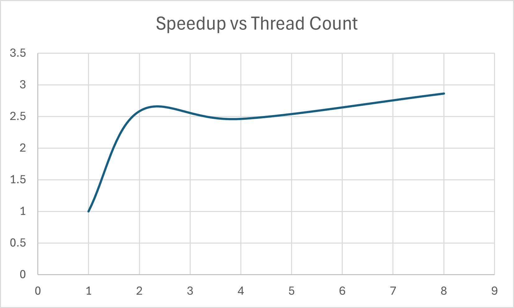
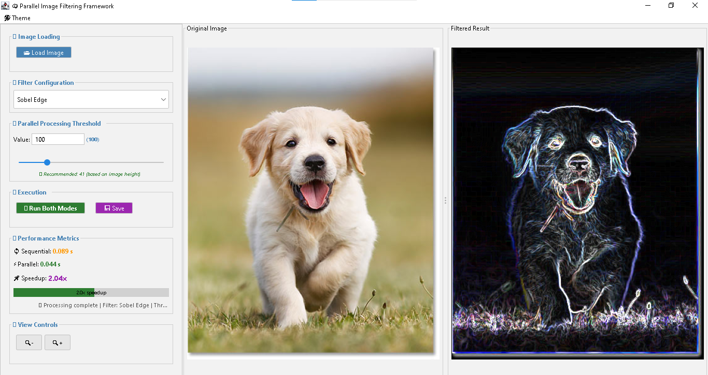

# 🍌 Parallel Image Filtering in Java

This project implements **image filtering** (Gaussian Blur, Sharpen, Sobel Edge) using both **sequential** and **parallel** processing. It includes a **modern GUI**, benchmarking tools, automated testing, and profiling support.

## 🎯 Features

✅ Sequential and parallel implementations of:
- Gaussian Blur
- Sharpen
- Sobel Edge Detection

✅ Parallel logic uses:
- Java Fork/Join framework
- Adjustable task threshold

✅ Modern GUI with:
- FlatLaf Dark Mode
- Image preview with zoom/pan
- Real-time speedup comparison (parallel vs sequential)
- Threshold control

✅ Benchmarking with thread sweep (1, 2, 4, 8)  
✅ JUnit 5 test automation with `.txt` output  
✅ VisualVM support for profiling CPU, memory, and threads  
✅ Fully runnable via `.bat` scripts (Windows)

## 📁 Folder Structure

├── src/
│ ├── filters/ # Filter interfaces & implementations
│ ├── processor/ # Image processing logic
│ ├── parallel/ # Fork/Join parallel tasks
│ ├── benchmark/ # BenchmarkRunner.java
│ ├── test/ # JUnit 5 test classes
│ └── ui/ # GUI (FilterGUI.java)
├── bin/ # Compiled classes
├── lib/ # JAR dependencies (JUnit, FlatLaf, etc.)
├── benchmark.csv # Benchmark results (for graph)
├── test-results.txt # Clean test log
├── *.bat # Scripts (rebuild, test, benchmark)
├── Dockerfile # Container instructions (Java + run benchmark)
├── run-docker.bat # Easy 1-click Windows runner
└── README.md

## 🧪 How to Use

### Prerequisites
- Java 17 or higher
- Windows (or WSL/Linux for manual compile)
- VisualVM (optional, for profiling)

### 🚀 Compile Project
Double-click: `rebuild.bat`

### 🖼️ Run the GUI
Double-click: `run-gui.bat`

### 📊 Run Benchmark
Double-click: `run-benchmark.bat`  
→ Outputs `benchmark.csv` for plotting speedup curve

### ✅ Run Tests
Double-click: `test.bat`  
→ Outputs to `test-results.txt`

## 📈 Speedup Chart (Example)

> This graph shows the achieved speedup of the parallel implementation compared to the sequential baseline.



> Max speedup observed: **2.86×** at 8 threads.

## 🧠 Profiling with VisualVM

1. Launch the app using `run-benchmark.bat`
2. Open VisualVM and attach to the running process
3. Use:
   - Monitor tab → CPU & memory
   - Threads tab → view Fork/Join worker threads
   - Sampler tab → view top-consuming methods
4. Save screenshots for report

## 🖼️ GUI Preview



## 🐳 Optional: Run via Docker
This project is fully containerized using Docker for portability and ease of execution.

### 🔧 Dockerfile Highlights
- Uses `eclipse-temurin:17-jdk` base image
- Compiles all Java source files inside the container
- Runs the benchmark automatically on container start

### 🏃 How to Use

**Build the Docker image:**
'''bash
docker build -t image-filter .

Run the benchmark:

```bash
docker run --rm image-filter
This will execute the BenchmarkRunner class and output timing/speedup results.

📦 Windows Shortcut
To build and run the container with one double-click, use: 'run-docker.bat'
